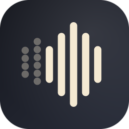
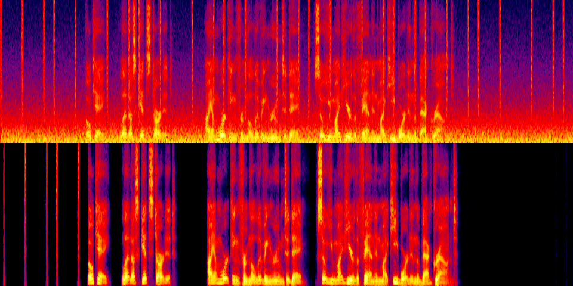
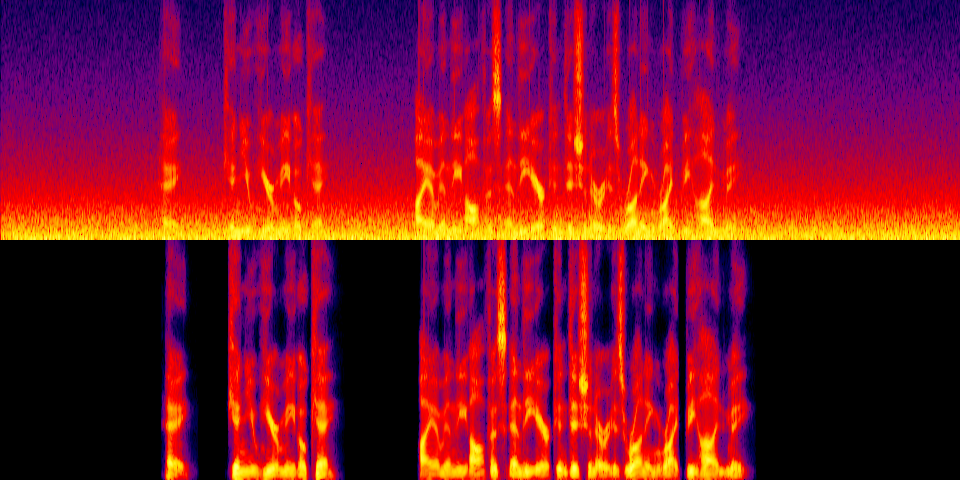
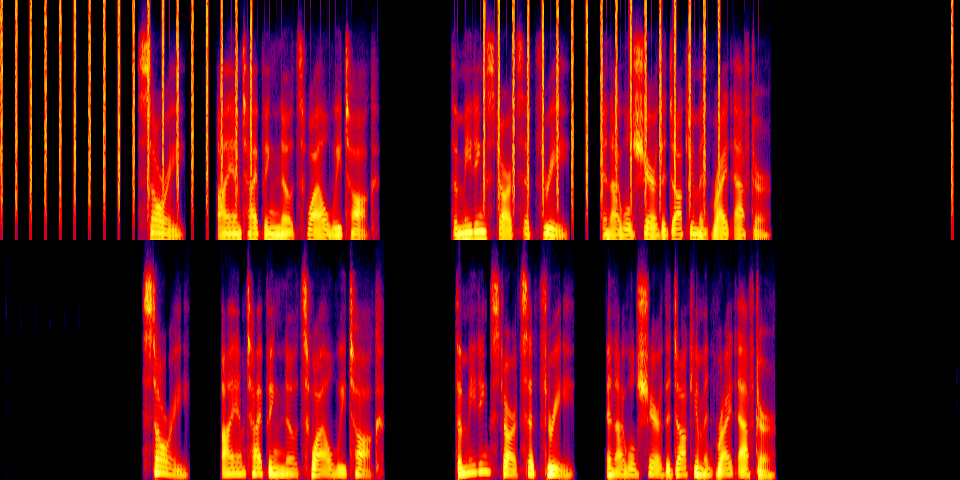
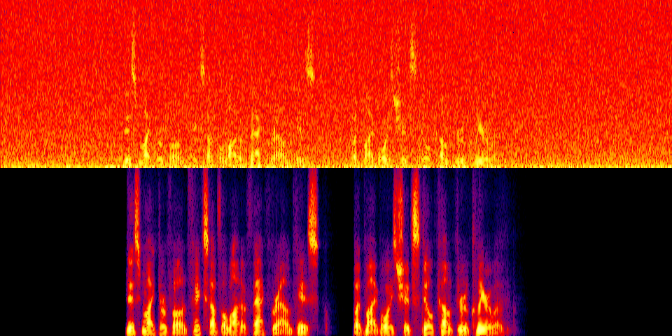
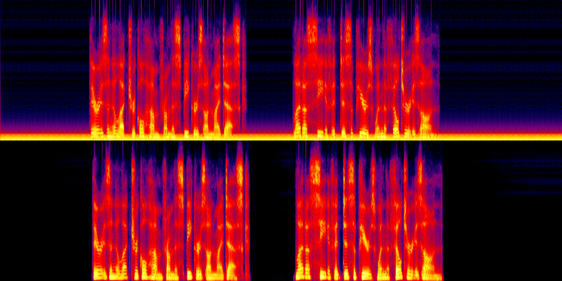

<div align="center">



# ClearVox

**Studio-clean voice for Discord, WhatsApp, Zoom and games.**
ClearVox cleans up your microphone in real time and gives every app a virtual mic with no fans,
keyboard clatter or hiss.

[](https://github.com/Cosmos-0118/ClearVox/actions/workflows/build.yml)
[](https://github.com/Cosmos-0118/ClearVox/releases)


[Install](#install) ·
[Hear it](#hear-it) ·
[Set up your apps](#set-up-your-apps) ·
[Troubleshooting](#troubleshooting) ·
[Build from source](#build-from-source)

</div>

---

## Why ClearVox

Chat apps have their own noise suppression, but it is often weak, inconsistent, or stacks badly with
other filters. ClearVox does the cleaning once, before your voice reaches any app.

- **Works everywhere.** Any app that lets you choose a microphone can use it.
- **Strong noise removal.** A neural denoiser on Windows, Apple Voice Isolation on Mac.
- **Lives in the tray / menu bar.** One switch to turn it on, and a few options if you want them.
- **Local and private.** Everything runs on your machine. No account, no cloud, no telemetry.
- **Light by design.** The best-quality Windows engine uses about half of one CPU core.

| | Windows | macOS |
| --- | --- | --- |
| Noise removal | DPDFNet neural denoiser (RNNoise as a light fallback) | Apple Voice Isolation / Voice Processing |
| Echo cancellation | No, use headphones | Yes, with Voice Processing |
| Extras | High-pass filter, auto gain, peak limiter | High-pass filter, auto gain, peak limiter |
| Virtual mic driver | [VB-CABLE](https://vb-audio.com/Cable/) | [BlackHole 2ch](https://github.com/ExistentialAudio/BlackHole) |
| Requires | Windows 10 / 11, 64-bit | macOS 13 Ventura or newer, Apple Silicon or Intel |

## Hear it

Each pair below is the same recording before and after ClearVox. Click a file to play it. The
spectrograms show frequency over time: speech is the bright bands, noise is the background haze.
Speech is synthetic (Windows text-to-speech) and the noise is simulated, so the tests are repeatable.

### A busy room

A fan and a keyboard at once, speech-to-noise ratio of about 3 dB. Cleaned with the default Windows
engine (DPDFNet-8, auto gain on).

| Before | After |
| --- | --- |
| [▶ room-noisy.mp3](docs/samples/room-noisy.mp3) | [▶ room-cleaned.mp3](docs/samples/room-cleaned.mp3) |



<sub>Top: original. Bottom: cleaned. The fan haze is gone and the voice stays. The first second or so
of keystrokes, before any speech, still slips through; the model has less context at the start of a
stream, and later keystrokes are removed.</sub>

### Common noises, controlled

One noise at a time, mixed in at a speech-to-noise ratio of 0 to 3 dB, which is very noisy. The
numbers are the level of the noise-only stretch before the speech starts.

| Noise | Before | After | Noise level when nobody speaks |
| --- | --- | --- | --- |
| Fan / air conditioner | [▶ noisy](docs/samples/fan-noisy.mp3) | [▶ cleaned](docs/samples/fan-cleaned.mp3) | −20 dBFS → silence |
| Keyboard clicks | [▶ noisy](docs/samples/keyboard-noisy.mp3) | [▶ cleaned](docs/samples/keyboard-cleaned.mp3) | −18 dBFS → −93 dBFS |
| Hiss (pink noise) | [▶ noisy](docs/samples/hiss-noisy.mp3) | [▶ cleaned](docs/samples/hiss-cleaned.mp3) | −20 dBFS → −121 dBFS |
| Mains hum (50 Hz) | [▶ noisy](docs/samples/hum-noisy.mp3) | [▶ cleaned](docs/samples/hum-cleaned.mp3) | −20 dBFS → −99 dBFS |

<details>
<summary>Spectrograms for each noise (top: before, bottom: after)</summary>

<br />






</details>

<sub>Samples were produced with the Windows build: `clearvox.exe --process-file in.wav out.wav --engine dpdfnet8 --agc`.
You can run the same command on your own recordings. Results on real rooms vary with the mic and the noise.</sub>

---

## Install

### Windows

Open **PowerShell** and run:

```powershell
irm https://raw.githubusercontent.com/Cosmos-0118/ClearVox/main/install.ps1 | iex
```

The installer:

1. Installs the **VB-CABLE** virtual audio driver. Windows asks for administrator approval once, and
   the download is checked against a pinned SHA-256. If Windows asks you to restart, restart and run
   the installer again.
2. Installs ClearVox to `%LOCALAPPDATA%\ClearVox`, adds a Start Menu shortcut and starts it.

ClearVox is not code-signed. If you download `clearvox.exe` by hand, SmartScreen may warn you: click
**More info → Run anyway**. The installer avoids this.

### macOS

Open **Terminal** and run:

```bash
curl -fsSL https://raw.githubusercontent.com/Cosmos-0118/ClearVox/main/install.sh | bash
```

Or download the repository ZIP, right-click `Install ClearVox.command`, choose **Open**, then **Open** again.

The installer:

1. Installs **BlackHole 2ch** (free, open source, checksum-verified).
2. Downloads the latest ClearVox release, or builds it from source if none is published. Building may
   prompt you to install Apple's Command Line Tools.
3. Installs `ClearVox.app` into **Applications** and starts it.

You will be asked for your Mac password once, to install the audio driver. Nothing appears while you
type it; that is normal. Click **OK** when macOS asks for microphone access.

---

## Set up your apps

In each app, choose the virtual mic as the **microphone**. Leave the speaker as your real
speakers or headphones.

| App | Microphone | Speaker |
| --- | --- | --- |
| Discord, WhatsApp, Zoom, Teams, Meet | **CABLE Output** (Windows) / **BlackHole 2ch** (Mac) | your speakers or headphones |
| Games | the same, or "Default" with *Use as Default Mic* on | your speakers or headphones |

> [!WARNING]
> Never set an app's **speaker** to *CABLE Input* or *BlackHole*. That sends the other person's voice
> back into your mic and causes feedback.

In **Discord**, also turn off *Noise Suppression* and *Automatic Input Sensitivity* under
*Voice & Video*. ClearVox already does that work, and stacking both sounds robotic.

---

## Using ClearVox

Click the ClearVox icon in the system tray (Windows, it may be under the ^ arrow) or the menu bar (Mac).
On Windows the icon is green when on, grey when off, amber on an error, and its mic fills as you speak.

| Setting | What it does |
| --- | --- |
| **On / Off** | Starts or stops processing. |
| **Microphone** | The real mic to clean up. |
| **Virtual Mic** | Where cleaned audio goes. Leave it on the cable / BlackHole device. |
| **Noise Suppression** *(Windows)* | The neural denoiser. Turn it off to hear the difference. |
| **Voice Engine** *(Windows)* | *Best quality* (DPDFNet-8, default, about half a CPU core), *Lighter on CPU* (DPDFNet-2), or *Minimal* (RNNoise, tiny but can garble speech under loud close noise like a fan). |
| **Voice Isolation** *(Mac)* | Apple's strongest noise removal. Best with headphones. |
| **Voice Processing** *(Mac)* | Noise removal plus echo cancellation. Use on laptop speakers. |
| **Reduce Air Thumps** | 90 Hz high-pass: rumble, desk bumps, breath pops. |
| **Peak Limiter** | Stops sudden loud sounds from clipping. |
| **Auto Gain** | Evens out your level while you talk. |
| **Use as Default Mic** | Makes the virtual mic the system default while ClearVox runs, so apps pick it up automatically. Your real default is restored when you quit. |
| **Open at Login** | Starts ClearVox when you sign in. |

Windows settings are stored in `%APPDATA%\ClearVox\settings.json`.

## How it works

```
Windows
  Mic ─► high-pass ─► DPDFNet denoiser ─► auto gain ─► limiter ─► CABLE Input ─► apps use "CABLE Output"

macOS
  Mic ─► Apple voice processing ─► high-pass ─► limiter ─► BlackHole 2ch ─► apps use "BlackHole 2ch"
```

ClearVox captures your real mic, cleans it, and plays the result into a virtual audio cable. Apps
record from the other end of that cable. ClearVox refuses to play into anything that is not a
virtual cable, so it can never send your voice to your real speakers by itself.

---

## Troubleshooting

<details>
<summary><b>The other person hears a whine or echo</b></summary>

That is acoustic feedback. Check that no app has its *speaker* set to the virtual cable, and wear
headphones. On Mac you can also switch to **Voice Processing**, which cancels echo. Windows has no
echo cancellation, so headphones matter more there.
</details>

<details>
<summary><b>Nobody can hear me</b></summary>

ClearVox must be **On**, and the level meter should move when you speak. The app must use the
virtual mic (*CABLE Output* / *BlackHole 2ch*) as its microphone. Check that microphone access is
allowed: *Settings → Privacy & security → Microphone* on Windows, *System Settings → Privacy &
Security → Microphone* on Mac.
</details>

<details>
<summary><b>"VB-CABLE" or "BlackHole" isn't installed</b></summary>

Run the installer again. Restart your computer if the driver still does not appear.
</details>

<details>
<summary><b>I connected AirPods or a headset</b></summary>

ClearVox keeps using the mic chosen in its menu, and restores its virtual mic as the default if the
system switches. To use the headset's own mic, pick it under **Microphone**. Bluetooth headset mics
lower sound quality while in use, so the built-in mic often sounds better.
</details>

<details>
<summary><b>My default microphone is still the virtual mic after quitting</b></summary>

ClearVox restores your default on a normal quit, but not after a crash or force-quit.
On Windows run `%LOCALAPPDATA%\ClearVox\clearvox.exe --restore-default`. On Mac choose your real
mic in *System Settings → Sound → Input*.
</details>

<details>
<summary><b>macOS says ClearVox is from an unidentified developer</b></summary>

Right-click ClearVox in Applications, choose **Open**, then **Open** again. The installer normally
prevents this.
</details>

## Uninstall

Windows (PowerShell):

```powershell
irm https://raw.githubusercontent.com/Cosmos-0118/ClearVox/main/uninstall.ps1 | iex
```

macOS (Terminal):

```bash
curl -fsSL https://raw.githubusercontent.com/Cosmos-0118/ClearVox/main/uninstall.sh | bash
```

This removes the app, its settings and login entry, and restores your default mic. The virtual
driver is kept because other apps may use it. Remove VB-CABLE under *Settings → Apps*. On Mac, run
`uninstall.sh --blackhole` to remove BlackHole too.

---

## Build from source

### Windows

Requires stable Rust with the MSVC toolchain (Visual Studio Build Tools, "Desktop development with
C++"). Run from PowerShell, not Git Bash.

```powershell
cd windows
cargo build --release          # about 45 MB: the DPDFNet models are compiled in
cargo test --release --lib     # unit tests
```

Noise-suppression regression test (needs `ffmpeg` on PATH):

```powershell
./tests/make_fixtures.ps1
cargo test --release --test denoise -- --nocapture
```

Command-line options:

```powershell
clearvox.exe --list-devices
clearvox.exe --selftest [--mic TEXT] [--file in.wav] [--seconds 8] [--engine dpdfnet2]
clearvox.exe --process-file in.wav out.wav [--engine rnnoise|dpdfnet2|dpdfnet8] [--agc]
clearvox.exe --restore-default
```

More in [`windows/README.md`](windows/README.md).

### macOS

Requires Xcode 15.3+ or the Command Line Tools (Swift 5.9+).

```bash
cd mac
./build.sh                 # native build -> mac/build/ClearVox.app
UNIVERSAL=1 ./build.sh     # arm64 + x86_64
open build/ClearVox.app
```

Run `CLEARVOX_FROM_SOURCE=1 ./install.sh` to install your local build with the full setup.
`ClearVox --selftest` runs the pipeline for 8 seconds and prints levels, devices and buffer
underruns/overflows.

### Repository layout

| Path | Contents |
| --- | --- |
| [`windows/`](windows) | Rust app: WASAPI capture and render, DPDFNet / RNNoise denoising, tray UI. |
| [`mac/`](mac) | Swift menu-bar app using Apple voice processing. |
| [`assets/`](assets) | Logo and icon sources. |
| [`docs/`](docs) | Audio samples and spectrograms used in this README. |
| `install.*`, `uninstall.*` | One-click installers for both platforms. |

### Releasing

Push a version tag. GitHub Actions builds the release artifacts and attaches them to a release, which
the installers then download.

```bash
git tag v1.0.0 && git push origin v1.0.0
```

---

## Credits

- [DPDFNet](https://github.com/ceva-ip/DPDFNet) by Ceva (Apache-2.0), a DeepFilterNet2-based speech enhancer, run with [tract](https://github.com/sonos/tract).
- [RNNoise](https://github.com/xiph/rnnoise) via [nnnoiseless](https://github.com/jneem/nnnoiseless) (BSD-3-Clause), the light fallback engine.
- [VB-CABLE](https://vb-audio.com/Cable/) by VB-Audio, the Windows virtual audio cable (donationware, installed separately, not bundled).
- [BlackHole](https://github.com/ExistentialAudio/BlackHole) by Existential Audio, the macOS virtual audio driver (GPL-3.0, installed separately, not bundled).
- Apple's voice processing frameworks (AVFoundation / Core Audio).
